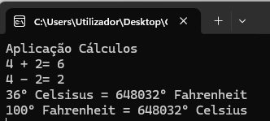

# Cálculos :1234:
Aplicacao C# para efetuar diferentes tipos de calculos.

Desenvolvida no âmbito da ação de formação **Introdução ao Git e Github**
## Operações suportadas
Neste momento esta aplicação implementa as seguintes operações:
- soma
- subtração
- conversão de temperaturas
    - celsius :arrow_right: fahrenheit
    - fahrenheit :arrow_right: celsius
## Tecnologias utilizadas neste projeto
- Visual Studio
- C#
- Git
- Github Desktop
- Plataforma Github

